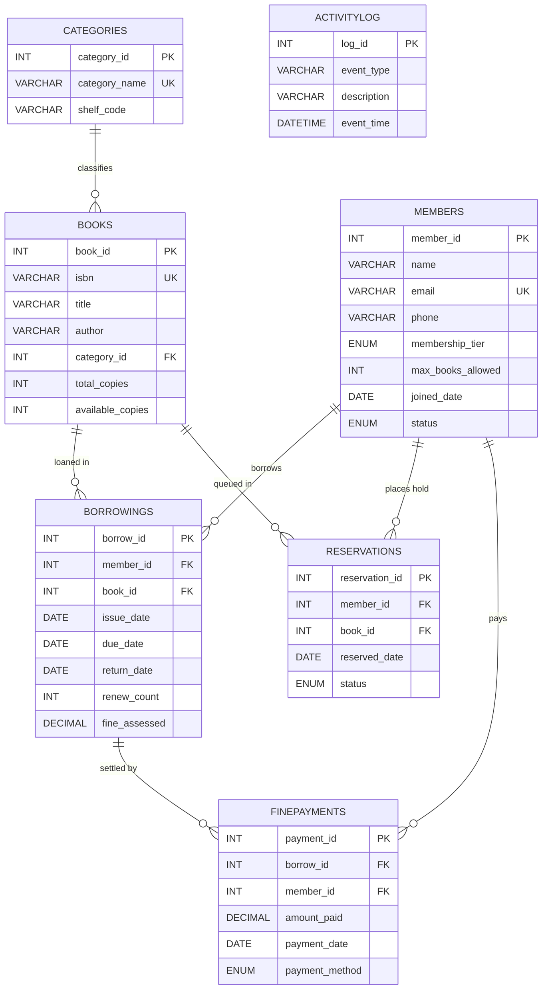

# 📚 Library Management System — Enhanced SQL + Interactive `.exe` Simulator

An enhanced relational database project featuring both **complete MySQL 8.0+ scripts** (7 normalized tables, triggers, stored procedures, views, constraints) and a **standalone native Windows desktop simulator (`LibraryManagementSystem.exe`)** powered by a real embedded SQL relational engine (`winsqlite3.dll`).

---

## 🚀 Play Now (Standalone Desktop App)

Double-click **`LibraryManagementSystem.exe`** (no installation, server setup, or external libraries required — it automatically creates `library_data.db` on first launch).

### What You Can Do Inside `LibraryManagementSystem.exe`:
- **⏩ Time-Travel Clock (`+1 Day`, `+7 Days`)**: Advance the simulated library date and watch active loans transition from `ON TIME` → `DUE SOON` → `OVERDUE`, while tier-based late fines accrue automatically in SQL views.
- **🎲 Rush Hour Simulator**: Click **Rush Hour!** to simulate random library activity (members borrowing books, returning overdue copies, auto-fulfilling waitlist holds, or queueing for out-of-stock titles).
- **🔄 Circulation Desk**: Issue books (enforces member tier limits, `Active`/`Suspended` status, and stock via SQL `BEFORE/AFTER INSERT` triggers), return books, and renew loans (+7 days, blocked if another member has a hold).
- **👥 Membership Tiers**:
  - **Student**: Max 3 books • 10-day loan • ₹5/day late fine
  - **Premium**: Max 5 books • 15-day loan • ₹3/day late fine
  - **Faculty**: Max 8 books • 30-day loan • ₹2/day late fine
- **📌 FIFO Hold Queue & 💰 Fine Cashier**: Place reservations on out-of-stock books, fulfill waitlist holds on return, and collect partial/full fine payments via `UPI`, `Cash`, or `Card`.
- **💻 Live SQL Studio**: Run 8 built-in DBMS viva queries (`JOIN`, `GROUP BY`, `NOT IN` subquery, views, schema introspection) or write and execute **any custom SQL query** (`F5` / `Ctrl + Enter`), plus watch the live SQL execution ticker at the bottom of the window.
- **💾 Export to MySQL (`.sql`)**: Export your live simulated database state directly into a MySQL Workbench script anytime.

---

## 📁 Project Files

| File | Purpose |
| :--- | :--- |
| `LibraryManagementSystem.exe` | Standalone 64-bit Windows GUI application & SQL simulator. |
| `src/LibraryApp.cs` | Complete C# source code (native `winsqlite3.dll` engine + WinForms UI). |
| `build.bat` | One-click script to recompile `LibraryManagementSystem.exe` using built-in `.NET` `csc.exe`. |
| `library_management_full.sql` | **All-in-One MySQL 8.0+ Master Script** (7 tables, 3 triggers, 3 stored procedures, 3 views, sample data, reports). |
| `01_schema.sql` | MySQL DDL: 7 tables, `CHECK`/`UNIQUE`/`FOREIGN KEY` constraints, and 3 stock/audit triggers. |
| `02_sample_data.sql` | Rich sample dataset covering all tiers, overdue loans, hold queues, and partial payments. |
| `03_queries_and_views.sql` | Analytical views (`vw_ActiveBorrowings`, `vw_MemberLedger`, `vw_BookPopularity`), stored procedures (`sp_IssueBook`, `sp_ReturnBook`, `sp_RenewBook`), and viva queries. |
| `04_presentation_demo.sql` | Step-by-step MySQL Workbench script for your live viva demonstration. |

---

## 🗺️ Enhanced ER Diagram (7 Tables)

